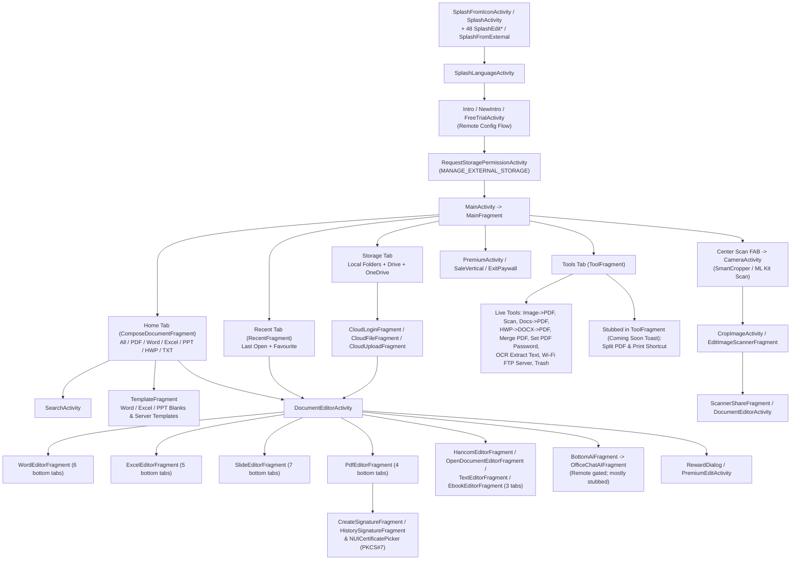

# Phase 1 Competitor Reverse Engineering Blueprint: `com.officedocument.word.docx.document.viewer`

**Project:** E05 — Native Android Application (Kotlin + Jetpack Compose, MVI + Clean Architecture)  
**Company:** Evora Technologies Global  
**Prepared by:** App Reverse Engineer (`app-reverse-engineer`), Mobile Architecture & Reality Check (`reality-checker`)  
**Date:** 2026-11-25  
**Target Artifact:** `com.officedocument.word.docx.document.viewer` (*Word Document: DOCX, PDF, XLSX* / *Office App - DOCX, PDF, XLSX* by `iKame Applications - Begamob Global`)  
**Upstream Market Report:** [`01_MARKET_RESEARCH.md`](01_MARKET_RESEARCH.md) · [`office_viewer_ua_business_evaluation.md`](../research/phase1/office_viewer_ua_business_evaluation.md)  
**Status:** **`COMPLETE`** — Pulled directly from Google Play installation on physical device (`SM_A165F` / `RF8Y60B9NCZ`), inspected via REA (`inspect_apk_signature`, `open_binary`, `inspect_artifact`, `inspect_analysis_view`, `inspect_native_exports`), Apktool `3.0.3`, JADX `1.5.3` (`36,204` decompiled classes, 99.75% success), and ELF64 header inspection.

---

## Executive Summary & Technical Feasibility Verdict

1. **The Core Secret Behind Their Multi-Format Suite:** Begamob did **not** write an Office suite or document layout engine from scratch. Decompilation proves the core viewing, editing, reflow, annotation, PDF serialization, and DOCX/PDF export engines are **Artifex SmartOffice (`libso.so`, 16.5 MB, `13,603` native exports, `com.artifex.solib` + `com.artifex.sonui.*`)** paired with **Artifex MuPDF (`libmupdf_java.so`, 13.0 MB, `10,161` native exports with embedded `tesseract::TessBaseAPI`)**, supplemented by **Apache `PDFBox-Android` (`com.tom_roush.pdfbox`)** for PDF merge/encryption/creation, **`PDFCreator` (`com.tejpratapsingh.pdfcreator`)**, **`DrawingView` (`com.raed.drawingview`)**, **`SmartCropper` (`libsmart_cropper.so` 5.2 MB + `libtensorflowlite_jni.so` 4.3 MB + `hed_lite_model_quantize.tflite`)**, and **Google ML Kit (`Document Scanner` + `Text Recognition v2` + `Barcode Scanning`)**.
2. **Critical IP & Licensing Verdict ("Tái sử dụng công nghệ"):**
   - **ZERO Binary Reuse:** E05 **cannot** reuse or redistribute `libso.so` (`SmartOffice`), `libmupdf_java.so` (`MuPDF`), or Begamob's decompiled code/resources. Both **Artifex SmartOffice** and **Artifex MuPDF** are dual-licensed (**GNU AGPL v3** or **Paid Commercial OEM License**). Shipping AGPL v3 binaries in a proprietary closed-source Google Play app is legally non-compliant unless either E05 purchases a commercial OEM license from Artifex or publishes E05's entire source under AGPL v3.
   - **Safe Clean-Room Parity Strategy for 100% Feature Parity:** Every single working capability in the competitor app can be cleanly replicated for E05 in **Kotlin + Jetpack Compose + MVI** via either **(Option A) Zero-Royalty Open Stack** (`PdfiumAndroid` Apache 2.0 + `PDFBox-Android` Apache 2.0 + custom `OpenXML`/`Apache POI`/native Web/Canvas editor + **LibreOfficeKit / Collabora Android Core** `MPLv2` or clean RichText/Sheet/Slide engines + ML Kit `$0`) or **(Option B) Commercial OEM Document SDK License** (Artifex SmartOffice OEM / Nutrient / Foxit / Apryse) if instant Photoshop-grade fidelity across arbitrary legacy `.doc`/`.xls`/`.ppt` editing is prioritized for Phase 2 Charter.
3. **100% Feature Reality Check (What Actually Works vs. Marketing Stubs):**
   - **Real & Production-Grade:** Word/Excel/PPT viewing & editing (via SmartOffice), PDF annotation/highlight/e-signature & basic digital signing (PKCS#7 via `NUIDefaultSignerFactory`), PDF Merge, PDF Password encryption (`AES-128` via `PDFBox` + `BouncyCastle`), Image-to-PDF, Smart Camera Scan (`SmartCropper` + ML Kit Scanner fallback), ML Kit OCR (5 scripts: Latin, Chinese, Devanagari, Japanese, Korean), QR scanner, Wi-Fi FTP/FTPS server (`Apache FtpServer`), Google Drive + OneDrive (`MSAL` + Microsoft Graph), Print inside Editor, Home widgets (`Glance/AppWidget`), and Quick Settings tile.
   - **Server-Dependent (COGS + Privacy Risk):** **Hangul (`.hwp`, `.hwpx`, `.hwt`, `.hwdt`) conversion** does **not** run locally — files `<= 50 MB` are uploaded via multipart HTTP to **`https://office-convert.begamob.com/convert`** to produce `.docx`. In the editor, `HancomEditorFragment` only exposes `File`, `Page`, `Find` tabs (no inline text editing).
   - **Stubbed / Marketing Only (`R.string.coming_soon` / Unwired):**
     - **Split PDF** in Tools (`ToolFragment.btnSplit`) shows a `"Coming soon"` toast (`GenerateFileViewModel.splitPDF` merely copies the file and posts an empty list).
     - **Tools Print shortcut** (`ToolFragment.lnPrint`) shows a `"Coming soon"` toast (even though inside the Editor `BottomFileFragment -> onPrint()` works via `DocumentView.print()`!).
     - **AI Translate, Check Spelling, Generate Text** (`BottomAiFragment` / `BottomAiOptionFragment`) show `"Coming soon"` toasts; `OfficeChatAIViewModel` is empty (`$stable = 0`) and `OfficeChatAIFragment.handleActionSent()` executes no live LLM API request; entry is remote-gated behind `t.l["enableAi"]`.
     - **Track Changes & Review** (`BottomReviewFragment`, `ReviewRibbonFragment`): `ConfigOptions.TrackChangesFeatureEnabledKey` defaults `false`, `OfficeApp` never enables it, and `WordEditorFragment.setupBottomEditTab()` never attaches `BottomReviewFragment`.
     - **ID Card Scan mode** (`CameraFragment.showIdCardScannerView()`), **Continuous Scrolling checkbox** (`ViewModeDialog`), **PDF Watermark tool** (`DocMuPdfPageView.drawWatermark` is only Artifex's internal watermark hook), and **ZIP/RAR/7z archive extraction** (`FileExtKt.listExtractFile` exists with zero extractor code) are non-functional/absent.
4. **Root Cause of Competitor 1★ Reviews Verified in Bytecode:**
   - **App-Switch Interstitial Spam:** `OfficeApp.onCreate()` (`OfficeApp.java:375`) explicitly passes `DocumentEditorActivity.class` and `CameraActivity.class` into `IKSdkController.addActivityEnableShowResumeAd(...)`.
   - **Deceptive Save Paywall:** `UnlockFeature.java` gates `SAVE_HEADER`, `SAVE_BOTTOM_EDIT`, `SAVE_AS_BOTTOM_EDIT`, `EDIT_SAVE_FILE_AS`, and `EDIT_SAVE_FILE_PDF` behind Rewarded Ad / Premium dialogs (`DocEditorFragment.java:1596-1637`).
   - **Invasive Permissions & Ad-Lockscreen Risk:** Manifest retains `SYSTEM_ALERT_WINDOW`, `USE_FULL_SCREEN_INTENT`, `MANAGE_EXTERNAL_STORAGE`, and SDK lock-screen overlay activity `com.ikame.android.sdk.activity.IkmASideLock` (`showOnLockScreen="true"`, `turnScreenOn="true"`).

---

## 1. Decompiled App Architecture, Signatures & Tech Stack

### 1.1 Split APK Package, Signing & Native ABI Verification
*Verified directly via `rea` (`inspect_apk_signature`, `open_binary`, `inspect_artifact`, `inspect_native_exports`), `apktool 3.0.3`, and `python3 -I` ELF64 `PT_LOAD` header inspection.*

| Artifact / Field | Observed Value | Notes |
|---|---|---|
| **Package Name** | `com.officedocument.word.docx.document.viewer` | Version code `311200`, Version name `311200` (`apktool.yml`) |
| **SDK Floors** | `minSdkVersion: 26` (Android 8.0), `targetSdkVersion: 35` (Android 15) | Split APK bundle (`com.android.vending.splits.required=true`, `derived.apk.id=3`) |
| **Pulled Split APKs** | `base.apk` (`94,798,207` B) · `split_config.arm64_v8a.apk` (`43,734,926` B) · `split_config.xxhdpi.apk` (`4,375,279` B) | Total installed footprint: **142.9 MB** across 3 splits |
| **APK Signatures (`rea`)** | `v2` & `v3` verified on `base.apk` (SHA-256 `c28cd460...15a8`); `v1/v2/v3` on `arm64_v8a` split (`7c68c094...54d1`); `self_consistent: true` | Signer SHA-256: `d6fd8367adc8f428d7bef4eba69698c7a262b8e10d6117fbf28e276406f5b08f`<br>Play Source Stamp SHA-256: `3257d599a49d2c961a471ca9843f9376a262b8e...` |
| **JADX Coverage** | `36,204` decompiled classes (`90` method decompile failures = **99.75% clean coverage**) | Legacy code heavily obfuscated lambdas (`r2`, `h`, `C24691`), newer modules cleanly structured |

### 1.2 Native Shared Libraries (`lib/arm64-v8a/`) & 16 KB Page Alignment
All **20 native `.so` binaries** inside `split_config.arm64_v8a.apk` (`87.1 MB` unpacked / `85,104` 1K blocks) were audited via ELF64 `PT_LOAD` segment inspection. **All 20 report `p_align = 0x4000` (16 KB OK = `True`)**, meaning the binary is already 16 KB page-size compliant for Android 15/16 devices.

| Binary (`.so`) | Size (Bytes) | Native Exports (`rea`) | Origin / Purpose | License / Reuse Verdict for E05 |
|---|---:|---:|---|---|
| `libso.so` | `16,490,072` | `13,603` | **Artifex SmartOffice Core** (`com.artifex.solib.*`, `SOLib` native C/C++ OOXML/binary DOC/XLS/PPT layout & edit engine) | **AGPL v3 / Commercial OEM — DO NOT REUSE** |
| `libmupdf_java.so` | `12,960,992` | `10,161` | **Artifex MuPDF (`fitz`) + compiled-in `tesseract::TessBaseAPI`** | **AGPL v3 / Commercial OEM — DO NOT REUSE** |
| `libsmart_cropper.so` | `5,239,312` | `4,294` | `me.pqpo.smartcropperlib` (OpenCV + Intel TBB perspective crop & quad warp) | OpenCV/SmartCropper concepts replicable cleanly; do not copy `.so` |
| `libtensorflowlite_jni.so` | `4,320,472` | N/A | TensorFlow Lite JNI running `assets/models/hed_lite_model_quantize.tflite` (document edge detection) | **Apache 2.0** (replace with official TFLite / ML Kit Scanner) |
| `libc++_shared.so` | `1,304,848` | N/A | LLVM NDK C++ shared runtime | Standard NDK runtime |
| `libsigner.so` | `983,864` | `2` | Pangle SDK request signer | Ad SDK internal — Exclude |
| `libapplovin-native-crash-reporter.so` | `860,200` | N/A | AppLovin MAX native crash reporter | Ad SDK internal — Exclude |
| `libnativelib.so`, `libtt_ugen_layout.so`, `libnms.so`, `libapminsightb.so`, `libapminsighta.so`, `libpglarmor.so`, `libtobEmbedPagEncrypt.so` | `8,184` – `363,040` | N/A | ByteDance Pangle (`6.5.7.9`) anti-fraud / APM / dynamic layout native libs | Ad SDK internal — Exclude |
| `libimage_processing_util_jni.so`, `libandroidx.graphics.path.so`, `libsurface_util_jni.so`, `libdatastore_shared_counter.so`, `libbuffer.so`, `libfile_lock.so` | `4,896` – `32,544` | N/A | Jetpack CameraX, `androidx.graphics:path`, `androidx.datastore` native helpers | Standard Jetpack AndroidX dependencies |

### 1.3 Bytecode Architecture & Third-Party SDK Inventory
- **Hybrid Migration Architecture:**
  - **90% Legacy XML + DataBinding + ViewModels (`LiveData` / `SingleLiveEvent`):** `681` XML layouts (`base_apktool/res/layout/`), `BaseFragment`, `BaseDialog`, Hilt DI (`@HiltAndroidApp`, `@AndroidEntryPoint`, `@HiltViewModel`).
  - **10% Modern MVI + Jetpack Compose (Active Migration):**
    - `com.happydev.wordoffice.business.main.document.compose.*` (`ComposeDocumentFragment`, `DocumentListScreenKt`, `DocumentMainScreenKt`, `AppTypographyKt`, `AdsSlotState`) gradually replacing XML document lists with Jetpack Compose + `StateFlow`.
    - `com.happydev.editor.convert.ui.*` (`ConvertFragment`, `ConvertViewModel`, sealed `ConvertState`, sealed `ConvertUserAction`, sealed `ConvertUIEvent` over `EventChannel`) follows strict UDF/MVI patterns.
    - *Takeaway for E05:* Competitor carries years of XML/ViewBinding technical debt; E05 starts **100% Jetpack Compose + MVI** from Commit #1, eliminating fragment bloat.
- **Document & Utility Libraries Observed in DEX & Assets:**
  - **Office & PDF Engines:** Artifex `com.artifex.solib` + `com.artifex.sonui.editor` + `com.artifex.sonui.phoenix` + `com.artifex.mupdf.fitz`; `com.tom_roush.pdfbox` (`PDFBox-Android` + `fontbox` + `org.bouncycastle.jce.provider.BouncyCastleProvider` for 128-bit PDF encryption); `com.tejpratapsingh.pdfcreator` (`PDFViewerActivity`, `PDFCreatorActivity`).
  - **Scanning, OCR, Vision & Drawing:** `com.google.mlkit.vision.text` (`TextRecognition` v2 across `LATIN`, `CHINESE`, `DEVANAGARI`, `JAPANESE`, `KOREAN`), `com.google.mlkit.vision.documentscanner` (`GmsDocumentScanningDelegateActivity`), `com.google.mlkit.vision.barcode` (`BarcodeScanner` + CameraX in `CameraQRCodeFragment`), `SmartCropper` (`hed_lite_model_quantize.tflite`), `com.raed.drawingview` (freehand e-signature canvas), `com.esafirm.imagepicker`.
  - **Networking, Storage, Cloud, FTP:** `Retrofit 2` + `OkHttp 3` + `Gson` + `ChuckerInterceptor` (bundled even in release!); `androidx.room` (`DocumentDatabase`, `CustomConfigDatabase`, `WorkDatabase`, `MetricsDb`); `androidx.work.WorkManager` (`DailyNotifyWorker`, `FileNotifyWorker`); `Google Drive API v3` (`com.google.api.services.drive.Drive` + `GoogleSignIn`); `Microsoft OneDrive` (`com.microsoft.identity.client` MSAL + `com.microsoft.graph.requests.GraphServiceClient`); embedded `org.apache.ftpserver` (`FtpServer` + BKS keystore `"easy_file"` for FTPS).
  - **Crash, Telemetry, Monetization:** `Firebase` (`Analytics`, `Crashlytics`, `Remote Config`, `Performance`, `Messaging`/`FCM`), `Adjust SDK`, `Timber` + `CustomActivityOnCrash` (`DefaultErrorActivity` in `:error_activity`), `Google Play Billing 8.0.0`, `com.ikame.android.sdk` (`IKSdkController`, `IKBilling`, `IkmASideLock`, `IkmASideC`), and **10 mediated ad networks**: **AdMob / Ad Manager**, **AppLovin MAX**, **IronSource LevelPlay**, **Mintegral (`com.mbridge.msdk`)**, **Moloco (`com.moloco.sdk`)**, **InMobi (`com.inmobi`)**, **ByteDance Pangle (`6.5.7.9`)**, **Meta Audience Network (`com.facebook.ads`)**, **Vungle (`com.vungle.ads`)**, **Unity Ads (`com.unity3d.services`)**.

---

## 2. Screen Inventory, Navigation Topology & Feature Reality Matrix

### 2.1 Entry Points & Activity Architecture (`58+` Splash/Cover Aliases!)
- **Main Hub (`MainActivity` -> `MainFragment`):**
  - 5-item bottom navigation bar (`layout_main_bottom_bar.xml`):
    1. **Home (`ln_doc`):** Document list (`ComposeDocumentFragment` / `DocumentFragment`) with format filter tabs (`All`, `PDF`, `Word`, `Excel`, `PPT`, `TXT`, `HWP` via `MyDocumentType`), `Recent`, `Favourite`, Sort/Search, `Templates`, `Cloud Drive` drawer/shortcut, `Set App Default` banner, and inline Native Ads.
    2. **Recent (`ln_recent` -> `RecentFragment`):** `LastOpenFragment` + `FavouriteFragment`.
    3. **Center Floating Blue Scan FAB (`lottie_create`):** Launches `CameraActivity` / `ScanActivity` (ML Kit Scanner or SmartCropper Camera).
    4. **Storage (`ln_storage` -> `StorageFragment` -> `StorageDetailFragment`):** Folder browser + Cloud accounts (`Google Drive`, `OneDrive`).
    5. **Tools (`ln_tool` -> `ToolFragment`):** 3-section toolbox (`Convert`, `PDF Tool`, `May You Like`).
- **48+ File-Association Cover Activities (`SplashEdit{Word,Excel,Slide,PDF,HWP,Text}{,1..7}Activity`):** Registered across separate `ACTION_VIEW` intent-filters for granular Play Store / OS "Open With" attribution and "Set Default App" onboarding loops.
- **Auxiliary Entry Activities:** `SplashFromIconActivity` -> `SplashActivity` -> `SplashLanguageActivity` -> `IntroActivity` / `IntroHybridActivity` / `NewIntroActivity` / `NewIntroFreeTrialActivity` -> `IntroSetAppDefaultActivity` -> `RequestStoragePmsActivity` -> `MainActivity`, plus `SearchActivity`, `SplashScanActivity`, `SplashSignActivity`, `SplashTxtRecActivity`, `SplashNotifyActivity`, `SplashFromExternalActivity`, `SplashFromShortcutActivity`, `ExitActivity`, `PremiumActivity`, `PremiumSplashActivity`, `PremiumEditActivity`, `PremiumDynamicShortcutActivity`, `DocumentEditorActivity`, `CameraActivity`, `CropImageActivity`, `ScanActivity`, `ScanResultActivity`, `PDFViewerActivity`, `PDFCreatorActivity`, `SlideShowActivity`, `NUICertificateViewer`, `NUICertificatePicker`, `IkmASideLock`, `IkmASideC`.

### 2.2 Navigation Graph Topology



### 2.3 Exhaustive Feature Parity Matrix (Code-Verified Reality)

| Category | Competitor Feature | Verified Code Implementation (`jadx`) | Code Status | E05 Clean Implementation Path (100% Parity) |
|---|---|---|---|---|
| **Word (`doc/docx/dotx/docm`)** | View, zoom, reflow, search, page jump | `WordEditorFragment` + `DocumentViewDoc` (`libso.so`) | **Real** | Commercial Doc SDK OR LibreOfficeKit (`MPLv2`) / OpenXML + custom paged/reflow Canvas/Compose |
| **Word Editing (`6 tabs`)** | Font family/size, B/I/U/Strike, text & highlight color, cut/copy/paste, undo/redo, align (4), bullets/numbering, indent L/R, insert image/camera/shape, freehand draw, note, Save/Save As/PDF/Print/Share | `WordEditorFragment` tabs: `Edit`, `File`, `Insert`, `Page`, `Draw`, `Find` (`BottomEditListener`, `BottomInsertListener`, `BottomPageListener`, `BottomAnnotateListener`, `BottomFileListener`) | **Real** | Full `RichText` Compose/Canvas + OOXML serializer **OR** LibreOfficeKit / SmartOffice OEM license |
| **Word Track Changes & Comments** | Track changes toggle, accept/reject, comment navigation | `ReviewRibbonFragment` & `BottomReviewFragment` exist, **never added to `WordEditorFragment` tabs**; `TrackChangesFeatureEnabledKey = false` | **Hidden / Unwired** | **Competitor Beat:** Expose real DOCX `<w:ins>`/`<w:del>`/`<w:comment>` tracking in E05 Word Review tab! |
| **Excel (`xls/xlsx/xltx/xlsm`)** | Formulas (grouped via `getFormulae` + `Sum`), cell merge, 9-way align, number formats (Number/Currency/Accounting/Date/Percentage/Fraction), row/col insert/delete, freeze row/col/panes, cell width/height cm, charts rendering | `ExcelEditorFragment` (`BottomFile`, `BottomEdit`, `BottomInsertExcel`, `BottomFormulas`, `BottomFind`) + `DocumentViewXls` | **Real** | Commercial SDK OR `Apache POI` + formula evaluator (`poi-ss` / Formula4j) + custom Compose 2D frozen-pane Canvas Grid & MPAndroidChart/Vico |
| **PowerPoint (`ppt/pptx/pps/pot`)** | Slide navigation, Slideshow presentation (`SlideShowActivity`), insert image/photo/shape (`InsertShape`), duplicate/delete slide, shape fill/stroke color/width/dash, 4-way Z-order Arrange (`Front/Back/Forward/Backward`), draw, Save/PDF | `SlideEditorFragment` (`7` tabs: `Edit`, `File`, `Insert`, `Format`, `Annotate`, `Page`, `Find`) + `DocumentViewPpt` | **Real** | Commercial SDK OR `Apache POI` (`XSLF/HSLF`) + Compose interactive vector object canvas (drag/resize/z-order) + fullscreen presenter |
| **PDF (`pdf/wps/wpt/wpss`)** | Render, search, TOC outline, reflow, page jump, Highlight (`4 colors`/custom), Ink Draw, Note comments, Author metadata, handwritten e-Sign overlay (`CreateSignatureFragment` + `DrawingView`), Digital PKCS#7 Cert Sign (`NUICertificatePicker`/`Viewer`), Set/Remove AES-128 Password (`PDFBox` + `BouncyCastle`) | `PdfEditorFragment` (`4` tabs: `File`, `Annotate`, `Signature`, `Page`) + `DocumentViewPdf` (`libmupdf_java.so`) + `GenerateFileViewModel.setFilePassword` | **Real** | **`PdfiumAndroid` (`Apache 2.0`) / Android Jetpack `PdfRenderer`** + **`PDFBox-Android` (`Apache 2.0`)** for annotations, vector ink, e-Sign stamp embedding, PKCS#7 signing, AES-256 encryption |
| **HWP (`hwp/hwt/hwdt/hwpx`)** | Open HWP / HWP -> PDF | `Hwp2DocxStrategy` uploads file (`<=50 MB`) to **`https://office-convert.begamob.com/convert`** (`outputFormat=docx`), then opens DOCX in `HancomEditorFragment` (3 read-only tabs: `File`, `Page`, `Find`) | **Server-Backed View/Convert Only** | **Parity Note:** Client-side `.hwpx` is an open ZIP+XML standard (parseable locally in Kotlin at `$0`!); legacy `.hwp` binary OLE/HWP5 requires either a parser (`hwplib` Apache 2.0 Java port) or lightweight E05 microservice |
| **ODT / EPUB / TXT / CSV** | Read & convert to PDF | `OpenDocumentEditorFragment` (`.odt/.ods/.odp/.odf`), `EbookEditorFragment` (`.epub`), `TextEditorFragment` (`.txt/.csv`) — **3 tabs only** (`File`, `Page`, `Find`); read + search + Print/PDF | **View & Export PDF Only** | Native ZIP+XML ODF/EPUB HTML-to-Compose/WebView + PDF print pipeline (`$0`) + Kotlin `.txt`/`.csv` viewer & editor |
| **Converters** | DOC/XLS/PPT/HWP/ODT -> PDF; PDF -> DOCX | `Default2PdfStrategy` (`DocumentView.savePDF`), `Default2DocxStrategy` (`DocumentView.exportTo(..., "docx")`), `GenerateFileViewModel.createFilePDF` (Image->PDF) | **Real** | `PDFBox-Android` + native print/canvas for Image/Doc->PDF; **note:** clean local PDF->DOCX without MuPDF requires structured `PDFBox` text/layout extractor or lightweight conversion microservice |
| **PDF Utilities** | Merge PDF, Set PDF Password | `GenerateFileViewModel.mergePDF` (`PDFBox`) + `setFilePassword` | **Real** | `PDFBox-Android` (`PDFMergerUtility`, `PDPage` splitter, `StandardProtectionPolicy`) |
| **Split PDF & Print (Tools Tab)** | Split PDF by page range; Print shortcut in Tools | `ToolFragment.java:120-137` shows **`coming_soon` toast** (`splitPDF` only copies original file; in-editor `BottomFileFragment.onPrint()` works) | **Stubbed in Tools** | **Competitor Beat:** Build real page-range Split PDF (`PDFBox`), real PDF Compress, PDF Watermark, and real `PrintManager` shortcut in Tools! |
| **AI Tools (`Chat/Summarize/Translate/Spelling/Gen`)** | In-document AI assistant | `BottomAiFragment` / `OfficeChatAIFragment`: gated by `t.l["enableAi"]`; `TRANSLATE`, `CHECK_SPELLING`, `GEN_TEXT` show `coming_soon`; `OfficeChatAIViewModel` empty; `handleActionSent` has no LLM API call | **Marketing Stub** | Phase 2 Decision: Keep clean **$0 COGS** offline utilities first, OR offer optional BYOK / Tier-1 Pro AI summarize via metered backend in post-MVP |
| **Document Scanner + OCR** | Edge crop, perspective warp, filters, multi-page PDF, OCR 53 languages (`OCRLanguage.java`) | `CameraActivity` (`SmartCropper` OpenCV + `hed_lite_model_quantize.tflite`) OR `com.ikame.pdfscanner.ScanActivity` (ML Kit Doc Scanner); OCR via **ML Kit `TextRecognition` v2**; **ID Card mode = `coming_soon` toast** | **Real (except ID Card)** | **Google ML Kit Document Scanner + Text Recognition v2** (`$0`, no `CAMERA` permission needed) + multi-page ID Card template mode (**beat competitor!**) |
| **QR / Barcode Scanner** | Scan QR/barcodes -> copy/open result | `CameraQRCodeFragment` (CameraX + ML Kit `BarcodeScanner`) -> `QRCodeResultFragment` | **Real** | CameraX + ML Kit Barcode (`$0`) |
| **Wi-Fi File Transfer** | Phone <-> PC browser/FTP client file transfer | `FtpService` (`Apache FtpServer` on port `8989`/`8998`, optional FTPS `BKS`, Quick Settings `FtpTileService`) | **Real** | Lightweight embedded **Ktor CIO HTTP/WebDAV or FTP server** (`$0`, modern browser drag-and-drop UI in browser!) |
| **Cloud & System** | Google Drive, OneDrive, Recycle Bin, Shortcuts, Widgets, Auto-scroll, Auto File Detector | `GoogleCloudManager`, `OneDriveCloudManager` (`MSAL` clientId `2641fd11-d09f-4e8e-8b55-f0c7acd8b79f`), `TrashTable`, `INSTALL_SHORTCUT`, `WidgetRecentScanProvider`/`WidgetRecentSearchProvider`, `BottomReadModeView` auto-scroll, `NewFileDetectorService` | **Real** | Drive REST + MSAL/SAF; Compose **Jetpack Glance** home widgets; `Room` Trash & Drafts; explicit opt-in file monitor (not aggressive lockscreen!) |
| **ZIP/RAR/7z & Continuous Scroll & Watermark** | Archive extraction; continuous scroll checkbox; user PDF watermark | `FileExtKt.listExtractFile` has extensions only (zero unrar/7z code); `ViewModeDialog` continuous scroll checkbox -> `coming_soon`; `DocMuPdfPageView.drawWatermark` is Artifex trial hook only | **Absent / Stub** | **Competitor Beat:** Real `.zip/.rar/.7z` (`java.util.zip` / Apache Commons Compress / `p7zip-android`), true vertical continuous scroll, and real PDF watermark tool! |

---

## 3. UI/UX & Design System Extraction

*Verified directly from `base_apktool/res/values/colors.xml`, `styles.xml`, `dimens.xml`, `layout_main_bottom_bar.xml`, `fragment_tool.xml`, `AppTypographyKt.java`, and `.local/playstore_assets/ss_en_0.png`–`ss_en_4.png`.*

### 3.1 Color Palette & Format-Coding System
Competitor establishes instant scannability through **strict per-format color identity** across document icons, editor top app bars, primary CTAs, and selection handles:

| Design Token (`colors.xml`) | Hex Value | Semantic Usage in UI |
|---|---|---|
| `blue` / `color_base_blue` | `#2489FF` / `#2C76F3` | Primary Brand Accent (Active Home Nav Tab, Center Scan FAB, Text Links) |
| `bg_home` | `#F2F4F8` | Primary App Screen Background (Light surface container) |
| `white` / `text` / `color_gray_bbb` | `#FFFFFF` / `#000000` / `#BBBBBB` | Card Surface / Primary Ink Text / Inactive Tab & Disabled Label |
| `color_text_cancel` | `#ADB7C9` | Muted Secondary Action / Cancel |
| `color_green_cta` / `color_green_base` | `#3CC79A` / `#00B085` | Positive Export / Save / Success Accent |
| `color_doc_word` / `color_doc_toolbar` | **`#1563DB`** | Microsoft Word (`DOC`, `DOCX`, `DOCM`, `DOTX`) badge & editor toolbar |
| `color_doc_pdf` / `color_pdf_toolbar` | **`#FF5959`** | PDF (`PDF`, `WPS`, `WPT`, `WPSS`) badge & editor toolbar |
| `color_doc_excel` | **`#27AC14`** | Microsoft Excel (`XLS`, `XLSX`, `XLSM`, `XLTX`) badge & editor toolbar |
| `color_doc_slide` / `color_ppt_toolbar` | **`#FF7D05`** | PowerPoint (`PPT`, `PPTX`, `PPS`, `PPSX`) badge & editor toolbar |
| `color_doc_hwp` / `color_hwp_toolbar` | **`#0189DF`** | Hangul (`HWP`, `HWPX`, `HWT`, `HWDT`) badge & editor toolbar |
| `color_odt_toolbar` | **`#A724F8`** | OpenDocument (`ODT`, `ODS`, `ODP`, `ODF`) badge & editor toolbar |
| `color_ebook_toolbar` | **`#86B918`** | EPUB Ebook badge & editor toolbar |
| `color_doc_other` | **`#22A8F9`** | Plain Text / CSV badge & editor toolbar |

*(Note: No true Material 3 Dark Theme exists — `Theme.WordOffice` inherits `Theme.AppCompat.Light.NoActionBar` with `windowLightStatusBar = true`. E05 will add full adaptive Light + Dark `ColorScheme` in Compose!)*

### 3.2 Typography, Spacing & Grid Tokens
- **Font Family (`AppTypographyKt.java` & `styles.xml`):** **Poppins** across four explicit weights (`poppins_regular` 400, `poppin_medium` 500, `poppins_semibold` 600, `poppins_bold` 700).
- **Spacing & Scaling System (`dimens.xml`):** Uses `sdp`/`ssp` scalable units anchored near an **8dp/4dp rhythm**:
  - Screen padding: `10dp`–`16dp` (`@dimen/_10sdp`–`_16sdp`); Section divider `#F6F6F6` `1dp` height with `20dp` horizontal inset (`fragment_tool.xml:47`).
  - Bottom Bar height & icons (`layout_main_bottom_bar.xml`): Tab icons `28dp × 28dp` (`@dimen/_28sdp`), labels `10sp`, center elevated Scan FAB **`45dp × 45dp`** (`@dimen/_45sdp`, `2dp` elevation) with looping Lottie pulse (`anim_home_scan.json`).
  - Tool Grid Tiles (`fragment_tool.xml`): 3-column evenly weighted row, `40dp × 40dp` circular pill icons (`r25_tool`), soft pastel tints (`#FFF5EC`, `#FFF7E5`, `#EDF5FF`, `#E6F7E4`), `6dp` icon-to-label gap, `10sp` centered label, `13sp` bold section headers.
  - **Compose Editor / Reader Chrome (`ss_en_1.png`–`ss_en_4.png`):**
    - Top bar: Back + filename + Undo/Redo (`Word`/`PPT`) or Outline/Fullscreen/Share/Crown (`Pro`) + high-contrast `"Done"` text CTA (`@style/ReadFileTheme`).
    - Floating right vertical cursor thumb (`CursorView`) showing toast pill `"1/12"` on drag (`DocEditorFragment.updatePageDisplay`).
    - Persistent collapsible bottom toolbar docking: (a) expandable 2-row quick-action pill shelf, (b) horizontally scrollable `ViewPager2` action panel (`Edit`, `File`, `Insert`, `Format`, `Formulas`, `Annotate`, `Signature`, `Page`, `Find`).
    - Rich micro-interactions backed by **39+ Lottie JSON animations** (`anim_main_*.json`, `anim_intro_1..3.json`, `anim_scan_line.json`, `anim_word_to_pdf.json`, `anim_successfully.json`, etc.).
- **Accessibility Gaps Observed:** Bottom nav touch height + icon-only editor buttons drop below **48dp × 48dp** touch targets in dense toolbars, text colors occasionally fail 4.5:1 (`#BBBBBB` on `#FFFFFF`), and TalkBack `contentDescription` attributes are largely `@null` in legacy XML. E05 Compose UI will enforce `48dp` minimum targets and WCAG AA contrast.

---

## 4. Data Models, Databases & Backend Network Contracts

### 4.1 Local Room SQLite Schemas (`WorkDatabase_Impl.java:90-112`, `DocumentDatabase_Impl.java`, `CustomConfigDatabase_Impl.java`)

#### A. `DocumentDatabase` (Schema Identity Hash `a16c3f27470299d0b50c0049ae6b5a91`)
```sql
CREATE TABLE IF NOT EXISTS `FavouriteTable` (`path` TEXT NOT NULL, PRIMARY KEY(`path`));
CREATE TABLE IF NOT EXISTS `RecentTable`    (`path` TEXT NOT NULL, PRIMARY KEY(`path`));
CREATE TABLE IF NOT EXISTS `TrashTable`     (`path` TEXT NOT NULL, PRIMARY KEY(`path`));
CREATE TABLE IF NOT EXISTS `cloud_account` (
    `email` TEXT NOT NULL,
    `cloud_type` TEXT NOT NULL,      -- "google_drive" | "one_drive" | "drop_box" (enum only)
    `personId` TEXT,
    `firstName` TEXT,
    `lastName` TEXT,
    `displayName` TEXT,
    `authCode` TEXT,
    `googleIdToken2` TEXT,
    `photoUrl` TEXT,
    `background` TEXT,
    PRIMARY KEY(`email`)
);
```
*Critical Flaw for E05 to Fix:* `RecentTable`, `FavouriteTable`, and `TrashTable` store **only raw file paths** (`path TEXT PK`) — there is **no** `lastOpenedTimestamp`, **no** `lastScrollPage`/`scrollY` bookmark, **no** `trashedAt` expiry timestamp, **no** `originalPath` for trash restore after rename, and **no** `DraftRecovery` table for crash-safe editing! E05's Phase 6 Room schema will add full document metadata, reading position persistence, trash origin/expiry, and atomic draft-recovery checkpoints.

#### B. `CustomConfigDatabase` (Schema Identity Hash `187c877435dfdcfeeeb6a2aeaa9f4386`)
- `document_template` (`name` TEXT PK, `documentType` TEXT, `preview` TEXT, `download` TEXT)
- `notification` (`repeat` INTEGER PK, `delay` INTEGER, `enable` INTEGER, `notifyContent` TEXT)
- `notify_content` (`contentTitle` TEXT PK, `contentText` TEXT)
- `dialog_intro_dto` (`showCloud` INTEGER PK, `showFileToPDF` INTEGER, `showFtp` INTEGER, `showImageToPDF` INTEGER, `showMergePDF` INTEGER, `showRate` INTEGER)
- `rate_feedback` (`dateRange` INTEGER PK, `randomRange` INTEGER)

### 4.2 Domain State & MVI Event Models
- **Document Listing Item (`MyDocument`):** `{ path, displayName, iconId, gridIconId, modifyDate, size, childCount, isFavorite, isRecent, isAds }` — note `isAds` boolean slot directly embedded inside the document list model (`DocumentAdsItemKt`)!
- **Modern Convert MVI Contract (`com.happydev.editor.convert.ui.*`):**
  - `ConvertState`: `Idle` | `Converting(progress: Int, sourcePath: String, format: ConvertFormat)` | `Success(outputPath, fileName, format)` | `Error(message)`
  - `ConvertUserAction`: `ClickClose` | `ClickOpenFile` | `ClickShareFile` | `SubmitName(fileName)`
  - `ConvertUIEvent`: `NavigateBack` | `NotifyConvertError(message)` | `NotifyConvertSuccess(filePath)` | `OpenFile(filePath)` | `OpenShare(filePath)`
- **Auto-Scroll State (`MyDocumentViewModel.AutoScrollState`):** `{ isOn: Boolean, speed: Int (1..3), isPlay: Boolean? }`

### 4.3 Network APIs, Cloud Auth & Embedded Services
1. **HWP Server Conversion API (`NetworkModule.java:32`, `HwpConversionApiService.java:15-18`, `HwpConversionRepository.java:147-162`):**
   - **Base URL:** `https://office-convert.begamob.com/` (60s connect/read/write timeout; `ChuckerInterceptor` wired in release builds!).
   - **Endpoint:** `POST convert` (`multipart/form-data`)
   - **Parts:** `file` (`MultipartBody.Part`), `outputFormat` (`RequestBody`, `"docx"`), optional `password` (`RequestBody`).
   - **Client Validation:** File must exist, extension in `["hwp", "hwpx", "hwt", "hwdt"]`, size **`<= 52,428,800` bytes (50 MB)**. Mapped errors: `FileTooLarge`, `InvalidFileFormat`, `PasswordRequired`, `InvalidPassword`, `Timeout`, `ServerError`, `NetworkError`.
2. **Cleartext / S2S Config (`network_security_config.xml`):**
   - Permits cleartext on `127.0.0.1` and `"https://s2s.begamob.com"` (developer left `"https://"` prefix inside `<domain>` XML tag!).
3. **Cloud Storage Integrations:**
   - **Google Drive:** `GoogleSignIn` + `Drive.Builder(NetHttpTransport, GsonFactory, ...)` with pagination, upload (`FileContent`), download (`MediaHttpDownloader`), folder traversal.
   - **Microsoft OneDrive:** Microsoft `MSAL` (`res/raw/auth_config_multiple_account.json`, `client_id: "2641fd11-d09f-4e8e-8b55-f0c7acd8b79f"`, scopes `["Files.ReadWrite.All", "User.Read"]`) + Microsoft Graph SDK (`LargeFileUploadTask`).
   - **Dropbox:** Declared in `CloudDriveType.DROP_BOX` enum, **unimplemented** in `CloudInstance` (only switches Drive & OneDrive).
4. **Embedded Wi-Fi FTP/FTPS Server (`FtpService.java`):**
   - Foreground service (`dataSync`) running Apache `FtpServer` on port `8998` (`DEFAULT_PORT`), optional `ftps://` using `BKS` keystore `"easy_file"`, 600s idle timeout, configurable read-only/anonymous/password credentials, Quick Settings tile (`FtpTileService`).

---

## 5. Monetization, Ad Mediation, Tracking & Remote Config Mechanics

### 5.1 Google Play Billing 8.0.0 SKUs (`AdsConstant.java:14-16`)
Managed via `IKBilling` (`com.ikame.android.sdk.billing.IKBilling`) + `SDKIAPProductIDProvider`:
- **15 Subscription SKUs (`LIST_CONFIG_SUB`):**
  `weekly_599`, `sub_weekly_4_99`, `sub_1_month`, `sub_1_month_sale`, `sub_1_year`, `free_trial_7_days_fixed`, `free_trial_3_days_fixed`, `sub_1_year_sale`, `free_trial_7_day_20_off`, `sub_1_year_sale_3d`, `free_trial_7_day_hlw`, `sub_1_month_ex`, `sub_yearly_none_trial_25_99`, `sub_yearly_39_99`, `sub_yearly_29_99`.
- **5 One-Time / Lifetime SKUs (`LIST_CONFIG_PUR`):**
  `one_pay`, `one_pay_ex`, `one_pay_sale_newyear`, `one_pay_sale`, `life_time_39_99`.
- **Ad Removal Entitlement (`listPackageRemoveAds`):** `"remove_ads"` plus all 20 sub & purchase SKUs.
- **Paywall Funneling:**
  - Default paywall (`PurchaseAppFragment`): `sub_1_month` / `sub_yearly_none_trial_25_99` (preselected middle tier) / `life_time_39_99`.
  - Contextual upsells: `SaleVerticalFragment`, `SuperSaleFragment`, `SalePromotionFragment`, `SaleRemarketingFragment`, `SalePremiumExitDialog` (`free_trial_7_days_fixed`), `SalePremiumSuperSaleExitDialog` (`free_trial_7_day_20_off`), `NewIntroFreeTrialActivity` (`free_trial_3_days_fixed`), `PurchaseTrialOnlyDialog`.

### 5.2 Ad Placements, Encrypted Defaults & Rewarded Save-Lock (`UnlockFeature.java`)
- **Ad Inventory (`res/xml/remote_config_defaults.xml` & `ik_sdk_config.xml`):**
  - Encrypted Base64 mediation waterfall payloads under `prod_data_{reward,inter,open,widget}` and `sdk_data_{first_config,banner,banner_inline,inter,native,open,reward,nt_fs,default_config}` cached for `6000s` (`cache_config`).
  - Native ads injected directly into the Compose/XML document file list (`DocumentAdsItemKt`, `FirebaseConfig$ConfigInAppScript.enableAdsInList = true`) and main bottom (`"main_bottom"` / `"main_bottom_after"`).
- **Exact App-Switch Interstitial/Open-Ad Root Cause (`OfficeApp.java:375`):**
  ```java
  iKSdkController.addActivityEnableShowResumeAd(
      MainActivity.class, DocumentEditorActivity.class, CameraActivity.class,
      SplashLanguageActivity.class, SettingLanguageActivity.class, IntroActivity.class
  );
  ```
  Adding `DocumentEditorActivity` and `CameraActivity` to resume-ad triggers causes every app-switch (e.g., copying text from Chrome/Notes or picking a file) to fire a fullscreen resume ad on return.
- **Exact 33 Gated Features (`UnlockFeature.java`):**
  - Save/Export gates: **`SAVE_HEADER`**, **`SAVE_BOTTOM_EDIT`**, **`SAVE_AS_BOTTOM_EDIT`**, `EDIT_SAVE_FILE_AS`, `EDIT_SAVE_FILE_PDF`, `CONVERT_TO_PDF`, `CREATE_TEMPLATE`.
  - Formatting/Tool gates: Text/Background color, Strikethrough, Bullets/Numbering, Indent L/R, Insert Image/Camera/Shape, Shape fill/stroke, Draw mode/color, Highlight, Note mode, Add Sheet, Formulas, Number Format, Cell Size, Digital Sign, e-Sign, Extract Text (OCR language picker!).
  - When `apply_reward_ads` is true, tapping Done/Save on edited existing files triggers `showRewardDialog(UnlockFeature.SAVE_HEADER)` (`DocEditorFragment.java:1630-1637`) — directly confirming the 1★ user complaints!
- **Ad Optimization Tracking (`assets/ik_sdk_tracking_config.json`):** Adjust/Firebase "DEAR" event rules (`xdear_2`: >=2 external opens/24h; `dear_2`: >=2 reads/24h; `sad`: set-app-default >=1/168h; `edit`: >=1 edit/24h) + `FirebaseConfigKey` (31 remote config experiments including `tier_premium_config`, `long_term_script_ads` targeting `userDay >= 30`, `enable_ads_in_list`, `test_new_home`, `use_new_scan`).

---

## 6. Feature Gaps, Policy Traps & E05 Competitive Strategy

### 6.1 Competitor Technical Flaws & Root Causes vs. E05 Architectural Edge

| Competitor Flaw (Observed in Play Reviews & Bytecode) | Exact Root Cause Found in Decompilation | How E05 Outperforms & Eliminates It |
|---|---|---|
| **1. App-switch fullscreen ad spam** | `DocumentEditorActivity` & `CameraActivity` in `addActivityEnableShowResumeAd` (`OfficeApp.java:375`) + `LongTermScriptAds` extra inters after day 30 | **Zero resume ads inside active editor, scanner, or checkout flows**; App-Open ads restricted strictly to cold launch / Home hub with generous cooldown (`>= 60–90s`) |
| **2. Deceptive paywall after editing ("can edit but can't save")** | `DocEditorFragment.java:1596-1637` intercepts `SAVE_HEADER` / `SAVE_BOTTOM_EDIT` with `RewardDialog` / Paywall | **Never block saving user's own edited document.** Clearly label advanced Pro features upfront (e.g., Batch PDF, Cloud Sync, Custom Watermark, Multi-page OCR) + clean Rewarded unlock before starting a Pro action |
| **3. Crashes & lost edits on backgrounding** | Legacy `SmartOffice` `DocumentView.saveSilently(autoSaveFilePath)` (`DocEditorFragment.java:5074`) only saves to hidden `.filename` if storage permission succeeds (`quitActivity()` overloaded/skipped decompile due to complexity); no atomic SQLite draft ledger | **Atomic MVI Draft Recovery:** Periodic background autosave to app-private `files/drafts/` + Room `DraftEntity` recovery prompt on relaunch — **zero data loss even after OS process death** |
| **4. Invasive Permissions & Play Policy Landmines** | `SYSTEM_ALERT_WINDOW`, `USE_FULL_SCREEN_INTENT`, `IkmASideLock` (`showOnLockScreen="true"`, `turnScreenOn="true"` launching ads/features over keyguard), `NewFileDetectorService` (`foregroundServiceType="specialUse"`), `ChuckerInterceptor` active in release build! | **Zero overlay/lockscreen ad activities** (`NO SYSTEM_ALERT_WINDOW`, `NO USE_FULL_SCREEN_INTENT`), scoped `MANAGE_EXTERNAL_STORAGE` only with proper core disclosure, **ML Kit Document Scanner** (zero `CAMERA` permission needed!), strict R8 stripping of debuggers (`NO Chucker` in release) |
| **5. Broken "Coming Soon" Buttons & HWP Privacy Risk** | Split PDF, Tool Print, AI Translate/SpellCheck/GenText, ID Card Scan, Continuous Scroll show `"coming_soon"` toast; HWP uploads user private files (`<=50 MB`) unannounced to `office-convert.begamob.com` | Ship **zero fake buttons**: every visible tool (including **PDF Split**, **PDF Compress**, **PDF Watermark**, **Print**, **ZIP/RAR/7z**, **ID Card Scan**, **Continuous Scroll**) works locally at `$0` server COGS! Disclose cleanly if optional cloud HWP legacy conversion is ever used |
| **6. No Reading Memory & Weak Dark Mode** | `RecentTable` stores only `path`; UI locked to portrait (`screenOrientation="portrait"`) & Light mode | Persist last page + scroll offset + zoom per file; support **Dark Mode + Reader Sepia/Night themes**, **Landscape/Tablet responsive panes**, and **Jetpack Glance Home Widgets** |

### 6.2 Build vs. License Architecture Decision for Phase 2 Charter (100% Feature Parity)

Because **Artifex SmartOffice (`libso.so`) and MuPDF (`libmupdf_java.so`) CANNOT be reused due to AGPL v3**, CEO must approve one of two engineering strategies in Phase 2 (`docs/02_PROJECT_CHARTER.md`):

| Parity Strategy | Technology Stack for E05 | License / Upfront Cost | 100% Parity Effort & Fidelity | Strategic Recommendation |
|---|---|---|---|---|
| **Strategy 1: Pure Clean Open-Source Modular Stack (`$0` Licensing COGS)** | • **PDF Engine:** `PdfiumAndroid` (`Apache 2.0`) + `PDFBox-Android` (`Apache 2.0`) + custom Compose Canvas ink/e-Sign + BouncyCastle PKCS#7<br>• **Office Engine (`DOCX/XLSX/PPTX`):** **LibreOfficeKit Android (`MPLv2` — weak copyleft, proprietary-app friendly if LOK changes stay public)** OR **Custom Native Suite (`Apache POI` + Compose RichText/2D Sheet Grid/Vector Slide Canvas)**<br>• **HWP:** Open `.hwpx` parser in Kotlin (`ZIP+XML`) + `.hwp` (`hwplib` Apache 2.0)<br>• **ODT/EPUB/TXT/CSV/ZIP:** Native Kotlin / `Apache Commons Compress` / `p7zip`<br>• **Scan/OCR/QR:** **ML Kit Document Scanner + Text Rec v2 + Barcode** (`$0`)<br>• **Wi-Fi Transfer:** Embedded **Ktor CIO Web + WebDAV server** | **`$0` Royalties** *(R&D man-months only; watch APK size +16 KB NDK r28 build if LOK is compiled)* | **PDF/Scan/OCR/QR/Tools/FTP/Cloud:** **99–100% parity cleanly** (weeks)<br>**Office Full WYSIWYG Editing:** High engineering effort if building from scratch with `Apache POI`, OR ~25–35 MB extra `.so` stabilization if compiling **LibreOfficeKit (`MPLv2`)** for ARM64 (`16 KB` aligned) | **Recommended for MVP+:** Use **Pdfium + PDFBox + ML Kit + POI Viewer/Lite-Editor** to ship super-fast 4.8★ PDF/Scan/Converter powerhouse in MVP, or invest Sprint 2-4 into **LibreOfficeKit (`MPLv2`) ARM64 16KB build** for full Office parity with `$0` ongoing royalties |
| **Strategy 2: Commercial SDK License (Fastest Time-to-100%-Office-Edit Parity)** | License **Artifex SmartOffice Commercial OEM SDK** (exact competitor core!) OR **Nutrient (PSPDFKit) / Apryse / Foxit** + E05 Jetpack Compose shell | **High Fixed Capex** (commercial OEM quote required; typically `$10k–$50k+/yr` or revenue share) | **Fastest 1:1 Office WYSIWYG parity** across `.doc/.docx/.xls/.xlsx/.ppt/.pptx` + `.pdf` | Only viable if Phase 2 Charter allocates commercial SDK license budget against proven Tier-1 subscription LTV |

---

## 7. Verification Provenance

- **APK Extraction:** `adb pull` from `SM_A165F` (`RF8Y60B9NCZ`) -> `.local/competitor_apk/{base.apk, split_config.arm64_v8a.apk, split_config.xxhdpi.apk}`.
- **Signatures & Binary Analysis (`rea` MCP):** Verified via `inspect_apk_signature` and `inspect_native_exports` / `inspect_analysis_view`.
- **16 KB Alignment Check:** Verified via `python3 -I` ELF64 `PT_LOAD` segment `p_align == 0x4000` check across all 20 binaries in `.local/decompiled/arm64_split/lib/arm64-v8a/`.
- **Decompilation:** `apktool 3.0.3` + `jadx 1.5.3` (`--no-res`) inside `.local/decompiled/` (`99.75%` Java/Kotlin class recovery). All competitor binaries and decompiled sources remain isolated inside gitignored `.local/` and were never executed or queried against live competitor APIs.
